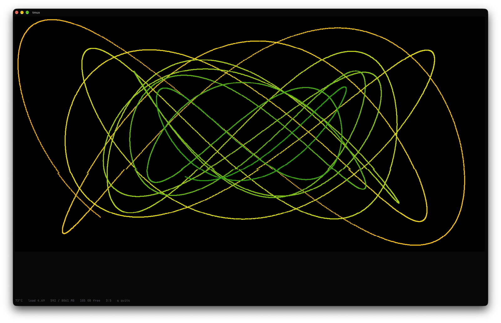
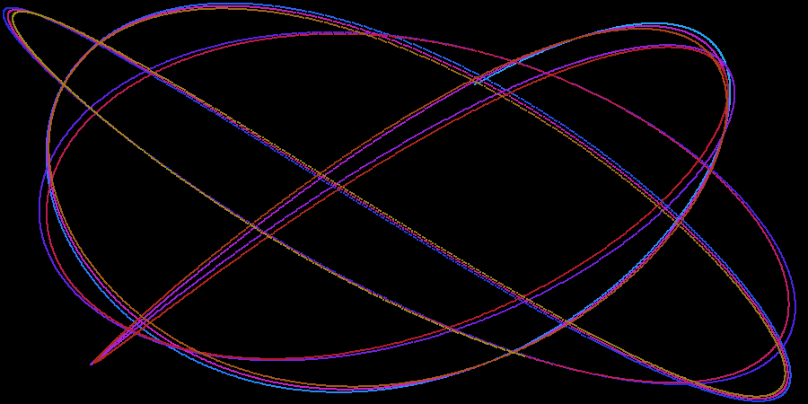
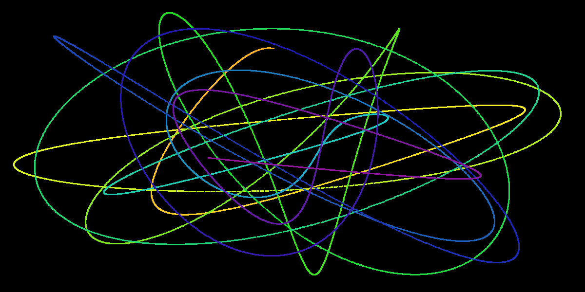

# health &nbsp;·&nbsp; `health`

**Your machine's health as a harmonograph: one figure, live in the terminal, that an idle box draws as a single clean curve and a busy one as a hot, shrinking tangle.**



<sub>↑ a Raspberry Pi 5 in the middle of a build, seen over ssh in Ghostty through tmux. The readings are the one muted line at the bottom; everything else is the figure saying the same thing.</sub>

> **▶ The idea:** two pendulums, one for X and one for Y, locked at a simple ratio, draw one closed Lissajous curve that stands still. That is the idle machine. Every reading is a *departure* from that picture, zero at idle: heat detunes the ratio and warms the hue, load damps each lap, memory adds a wobble, a full disk spreads the colour. You never read a number. You see whether the figure is calm.

[](LICENSE)
&nbsp;·&nbsp; [](#install)
&nbsp;·&nbsp; [](health)
&nbsp;·&nbsp; [](#ai-usage)
&nbsp;·&nbsp; Python 3.7+ · Linux and macOS · Kitty graphics, iTerm2, sixel, or Braille

---

## Why

`htop` gives you forty numbers. `uptime` gives you three. Both ask you to read, then judge.

`health` gives you one figure and lets your eye do the judging. A calm machine draws a calm figure, and the moment a build starts, the trace spirals in and the colour goes from blue to orange while the sensor is still warming. It is the cockpit-instrument idea: a shape you can glance at from across the room, not a table you have to sit down with.



<sub>↑ eighteen seconds through the tool's own renderer: idle, a build starts (load up, temperature climbing to 75 °C, memory filling), then the machine cools and the figure locks again. Scripted readings, real renderer (`health --demo`). Turn it on with a real build and it does this for real.</sub>

## What the figure says

| reading | idle | what it does to the figure |
|---|---|---|
| cpu temperature | 35 °C | **detuning**: the ratio slips, the figure precesses and fills in; and the **hue**, blue at 35 °C to red at 80 °C |
| load per core | 0 | **damping**: each lap smaller, the figure spirals in (last lap 40 % at one load per core) |
| memory in use | 0 % | the **second pendulum**: a wobble riding on the curve, as big as the curve at 100 % |
| disk used | 0 % | the **colour spread** along the trace: one hue when empty, the whole wheel when full |
| hour of day | | which locked ratio (2:3 … 5:7), the figure's family. The clock, not health |
| uptime | | the phase between X and Y, so the figure turns slowly. The clock, not health |

Every departure is zero at idle, so a quiet machine is a single closed curve in one cool colour:

| idle (38 °C, load 0.1, 15 % memory) | stressed (73 °C, load 4.7, 60 % memory, 80 % disk) |
|---|---|
|  |  |

<sub>↑ `health --png` with the readings pinned (`--readings temp=38,load=0.1,mem=0.15,disk=0.3` and `temp=73,load=4.7,mem=0.6,disk=0.8`). Same machine, same hour, same renderer.</sub>

The readings reach the figure with inertia (temperature and memory over about three seconds, load over two, the hour's ratio over about a minute), so a flickering sensor never makes it shiver and a real change arrives the way a machine warms: over a few seconds.

## Install

One file, standard library only. Python 3.7 or newer.

```sh
curl -fsSL https://raw.githubusercontent.com/arian-shamaei/health/main/install.sh | sh
```

That puts `health` in `~/.local/bin` and `man health` in `~/.local/share/man/man1`. Or by hand:

```sh
git clone https://github.com/arian-shamaei/health && cd health
install -m 755 health ~/.local/bin/health
install -D -m 644 health.1 ~/.local/share/man/man1/health.1   # optional
```

Uninstall: `rm ~/.local/bin/health ~/.local/share/man/man1/health.1`. Nothing else is written anywhere (one temporary PNG per frame under `$TMPDIR`, removed on exit).

## Use

```
health            the figure alone, as large as the window, about 10 frames a second; q quits
health 4          4 frames a second (0.5 to 20; fewer over a slow link)
health --braille  Braille dots instead of pixels, on any terminal
health --once     one drawing with the readings beside it (a login screen: instant, no animation)
health --png out.png [--readings temp=73,load=4.7,mem=0.6,disk=0.8,hour=14]
                  one frame to a PNG, from the readings now or as pinned
health --demo DIR frames of a scripted build, for a GIF of the renderer
```

On a terminal that draws pixels the frame is a PNG, rendered in pure Python and sent over the Kitty graphics protocol (Ghostty, kitty, WezTerm, also through tmux with `allow-passthrough on`), the iTerm2 inline-image protocol, or as sixels through [`chafa`](https://hpjansson.org/chafa/) when it is installed (Windows Terminal, foot, mlterm). Anywhere else the trace is Braille dots in 24-bit colour. `HEALTH_FORMAT=kitty|iterm|sixels` forces a protocol; `HEALTH_DEBUG=1` logs what the terminal answered.

A frame costs a Raspberry Pi 5 about 30 ms (the trace turns unit phasors by a constant complex step instead of calling four sines a point; the PNG is one byte a pixel, deflate level 1), so ten frames a second is about a third of one core. The figure shows that too, as a little damping.

### As a login screen

`health --once` is the form it was born in: the figure in Braille beside the raw readings, done in well under a tenth of a second, no pixels, nothing animates. Put it in `~/.bash_profile` behind an interactive-shell check and every login is a glance at the machine.

## Readings

Linux: `/sys/class/thermal` (or `hwmon`), `/proc/loadavg`, `/proc/uptime`, `/proc/meminfo`, `statvfs("/")`. macOS: `getloadavg`, `sysctl kern.boottime` and `hw.memsize`, `vm_stat`; there is no portable cpu temperature on macOS, so it reads as idle and the hue stays cool. No network is touched (the IP shown in `--once` comes from the routing table, no packet is sent).

## Origin

Built for the `rawr` account on a Raspberry Pi 5 named nyan, where it replaced the login screen's cat, and where a guest logging in should see at a glance whether the Pi is busy. The first version was a mirror-folded colour disc with a legend that explained the mapping with arrows. The second was a Lissajous figure with a floor on every term, so even an idle Pi drew a rainbow tangle. The third, this one, makes every departure zero at idle, which is the whole idea.

## AI usage

Vibe coded: written in Claude Code sessions and corrected by eye, frame by frame, in a real terminal. The mapping is the author's; the terminal protocol work (Kitty placeholders through tmux, sixel pixel sizes over Windows OpenSSH) was found by screenshotting real windows until they were right.

## Reproducing the figures

```sh
docs/render.sh    # idle.png, stressed.png, health.gif from the tool itself (needs ffmpeg for the gif)
```

The hero image is a real screenshot (`validate/mac.sh health` in the origin workspace), not a render.

## License

MIT.
